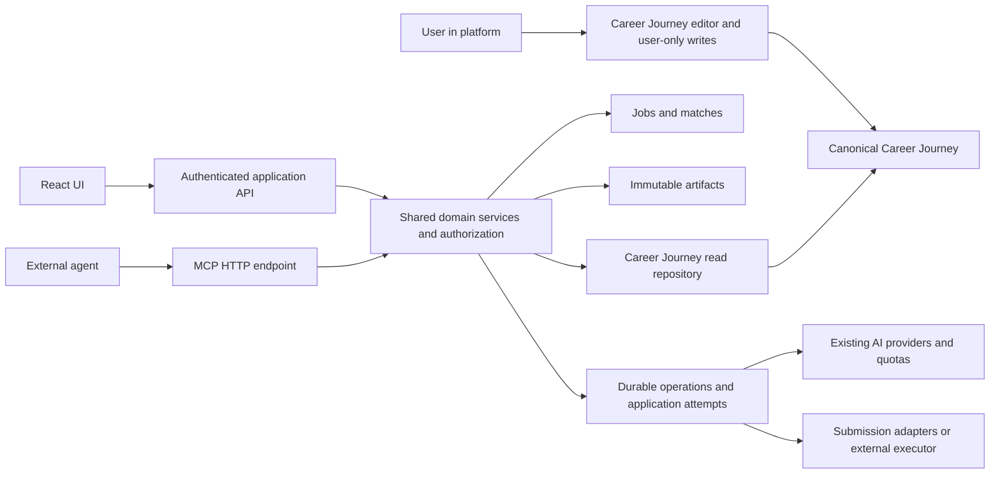

# Career Journey agent platform and MCP implementation plan

Status: proposed implementation plan; no platform behavior changed.
Prepared: November 12, 2026.
Baseline: `e29a466` on `main`.

## 1. Outcome and product boundary

Make Career Journey the shared system of record for a person's job search, whether work is performed by that person in the UI or by an authorized agent. Agents can discover and assess jobs, prepare and revise application materials, apply through supported execution paths, and maintain application, interview, follow-up, and offer records. The UI must show those changes and the exact materials used for each application.

**Career Journey is read-only for agents.** Only the user, working in the platform, can change canonical career facts, relationships, preferences embedded in the Career Journey, or version history. An agent can request clarification and point the user to the editor. It cannot approve or apply an update, indirectly trigger a write, or turn its own assertion into verified career evidence.

Interpret “all tasks a user can” as full job-search workflow parity with explicit capability controls. Account security, billing purchases, account deletion, platform administration, and canonical Career Journey edits remain user-controlled. Other user features, including Spotlight publishing and support messages, belong in the eventual parity inventory with separate scopes; they must not silently disappear from the roadmap.

The product supports both:

1. An external agent connected over MCP, using its own reasoning/browser tools while saving work to Career Journey.
2. Platform AI actions invoked over MCP, using the same generation, quota, and feature rules as the UI.

MCP is the interface to the platform. It does not, by itself, provide browser automation or access to employer ATS accounts.

## 2. Verified current state and implementation consequences

| Current implementation | Consequence |
|---|---|
| `src/data/FirestoreDataStore.ts` directly reads/writes `users/{uid}/jobs`, `matches`, and `careerJourney/current` through the client SDK. Job saves replace entire documents. | Add server repositories and domain commands; migrate cloud job/match writes before concurrent agent editing launches. Otherwise an old browser tab can overwrite agent work. |
| `src/store.ts` owns orchestration, prerequisites, stage advancement, edits, match promotion, and browser-memory AI task state. | Move relevant business rules into shared domain services, leaving Zustand as UI state/cache. Do not import the browser store into the MCP server. |
| `JobAnalysis` in `src/types.ts` embeds one current resume, cover letter, form answers, interview rounds, and offer. | Preserve compatibility while adding immutable artifact revisions, application attempts, and an append-only timeline. |
| `src/pages/ApplyStage.tsx` opens a job link and sets `appliedAt`/`applicationMethod`. | Real employer submission is new work. Tracking must distinguish manual reports, agent reports, and adapter-confirmed submissions. |
| Career Journey uses passthrough Zod schemas and some application/interview data lives inside that schema. | Use strict agent input schemas and explicit projections. Store new agent application/interview records outside Career Journey. |
| Jobs contain `careerJourneyPatch`, `pendingCareerJourneyUpdate`, and context/claim decisions. | Do not expose generic `Partial<JobAnalysis>` writes. Block indirect canonical updates and user-only claim approvals. |
| `hydrate()` loads data once; persistence is fire-and-forget. | Add live synchronization, acknowledged writes, revision conflict handling, and visible agent runs. |
| Firebase Auth verifies UI identity; local development can run with no Firebase. | Remote agent access must fail closed without configured identity/persistence. Never inherit the development auth bypass. |
| Firestore rules grant the owning Firebase user broad Career Journey and job writes; Admin SDK bypasses those rules. | Never give agents Firebase ID/refresh tokens, custom tokens, or service-account credentials. Enforce agent capabilities in server services. |
| Export routes generate PDF/DOCX from supplied documents; exports are not an immutable document library. | Persist structured revisions and exported bytes, then bind the application to exact artifact IDs and hashes. |
| Existing feature, billing, discovery, and AI-provider gates are server modules, but AI endpoint migration is partial. | Reuse those checks through services and test provider behavior; do not promise universal BYOM support as a side effect of MCP. |
| Storage/rules/index deployment is not assured in this environment. | Deployment verification with authenticated Firebase access is a release dependency, not something a code commit satisfies. |

Source files inspected: `ARCHITECTURE.md`, `README.md`, `src/types.ts`, `src/types/careerJourney.ts`, `src/data/DataStore.ts`, both DataStore implementations, `src/store.ts`, `src/pages/ApplyStage.tsx`, `server.ts`, `server/firebaseAdmin.ts`, `firestore.rules`, and `server/userData.ts`.

## 3. Target architecture



Keep the existing Express deployment initially. Mount `/mcp` and separate application routers without a broad restructuring of `server.ts`. Both REST and MCP call domain services directly; MCP must not make loopback HTTP calls pretending to be the UI.

Proposed modules:

```text
shared/contracts/                 strict commands, result types, revisions
server/domain/                    jobs, matches, artifacts, applications, interviews, offers
server/repositories/              tenant-scoped Firestore access
server/auth/agentPrincipal.ts     delegated identity and capability checks
server/auth/agentGrants.ts        consent, policy, revocation
server/mcp/                      transport, schemas, tools, error mapping
server/operations/               durable runs, workers, leases, cancellation
server/applications/             submission orchestration and adapter interface
server/artifacts/                revision storage, export and download access
src/lib/platformClient.ts        UI API client for shared commands
src/pages/AgentConnections.tsx   consent, grants, runs and revocation
```

Do not build a generic database proxy, arbitrary HTTP execution tool, arbitrary document path writer, or agent-visible admin API.

## 4. Authorization and the read-only guarantee

### 4.1 Delegated identity

Use a dedicated OAuth authorization server or maintained provider that supports the selected MCP clients. Firebase remains the user's platform login, linked to the authorization-server subject through a server-verified mapping. Firebase login alone is not a complete MCP OAuth authorization server.

The MCP endpoint is an OAuth resource server. Validate issuer, audience/resource, expiry, granted scopes, client identity, account status, and grant revocation on every request. Derive `uid` exclusively from verified identity. Never accept tenant identity from tool arguments.

Implement authorization-code flow with PKCE, exact redirect validation, consent, resource metadata/discovery, short-lived access tokens, refresh-token rotation/revocation, and separate credentials for each connection. Pin supported protocol/SDK versions after an interoperability spike; do not implement OAuth cryptography or token issuance from scratch.

Current MCP authorization and transport references were checked on November 12, 2026. The `latest` URLs currently resolve to the 2026-07-28 specification. Version negotiation and behavior must follow the pinned SDK, rather than copying older session/transport examples.

Sources: [MCP authorization](https://modelcontextprotocol.io/specification/2026-07-28/basic/authorization), [transport overview](https://modelcontextprotocol.io/specification/2026-07-28/basic/transports), and [official TypeScript SDK](https://github.com/modelcontextprotocol/typescript-sdk).

### 4.2 Principal and capability enforcement

Every shared command receives a trusted `Principal` with actor type (`user`, `agent`, `system`), owner UID, connection/client ID, grant ID, scopes, policy version, and request/run IDs. This context is constructed by middleware, not deserialized from tool input.

Proposed scopes:

| Scope | Allows |
|---|---|
| `journey:read` | Read/search selected canonical sections and evidence. |
| `jobs:read`, `jobs:write` | Inspect and manage pipeline jobs, notes, stages, archive/unarchive. |
| `matches:read`, `matches:write` | Inspect, scan, dismiss, promote matches and update search preferences. |
| `discovery:run` | Run configured discovery within existing availability/licensing gates. |
| `artifacts:read`, `artifacts:write` | Read, create, revise, render, export application documents. |
| `ai:run` | Run platform AI, consuming normal entitlements and quotas. |
| `applications:prepare` | Form answers, packets, submission preflight and handoffs. |
| `applications:submit` | Submit only under an effective user-granted submission policy. |
| `applications:record` | Record externally performed applications with provenance. |
| `interviews:write`, `offers:write` | Maintain interview, follow-up and offer records. |
| `spotlight:manage`, `spotlight:publish` | Manage/publish a public profile, separately consented. |
| `support:write` | Send user-owned support requests/replies, separately consented. |

There is **no `journey:write` agent scope**, no admin scope, and no fallback to all user permissions. Filter tool discovery by scopes and enforce scopes again on invocation; tool metadata is not an authorization mechanism.

### 4.3 Close indirect write paths

- Agent services receive only a read-capable Career Journey repository. Keep user write commands separate and explicitly reject agent principals.
- Forbid agent calls to Career Journey build/import, patch generation/approval, section-assistant mutations, interview-to-journey refinement, saved person/role resume defaults, migration, and canonical version bumps.
- Provide per-job resume build settings without modifying defaults stored in `person.resume_preferences` or `role.resume_default`.
- Agent notes, clarification requests, interview answers, and proposed factual corrections go into separate job-search records. They never merge into Career Journey automatically.
- A user can resolve a clarification by opening the existing platform editor. Refresh the canonical revision afterward and regenerate affected drafts as needed.
- An agent cannot mark an unsupported resume claim as “candidate approved” or supply user-only attestations. It can remove the claim, cite existing evidence, or request user review.
- Reject unknown fields recursively at write boundaries; never spread agent payloads into persisted documents or passthrough Career Journey schemas.
- UI-only write routes require a verified user principal. MCP tokens are rejected by legacy Firebase-auth routes; no token exchange grants agents a Firebase identity.
- This guarantee covers platform-issued agent credentials. A user separately handing an agent their full human login defeats that boundary and is not the supported connection model.

## 5. MCP surface and feature parity

Use narrowly described tools with strict input/output contracts and structured results. Reads should also be available as tools so clients need not support resource browsing. Add MCP resources/prompts only where the selected protocol/clients support them; they are conveniences, not dependencies for core workflows.

[MCP tool schemas and discovery](https://modelcontextprotocol.io/specification/2026-07-28/server/tools) guide the transport contract; domain permissions remain enforced by Career Journey.

Proposed catalog (names are implementation targets, not existing tools):

| Area | Tools and intended behavior |
|---|---|
| Bootstrap | `get_capabilities`, `get_search_summary`: scopes, available features, quota, policy, schema versions, supported adapters, blockers, dashboard counts. |
| Career Journey | `get_career_journey`, `search_career_evidence`: section filters, entity IDs, bounded results, canonical revision/hash and evidence provenance. No write tool. |
| Jobs | `list_jobs`, `get_job`, `create_job`, `update_job_details`, `transition_job`, `archive_job`, `restore_job`; deletion under a separately enabled destructive capability. |
| Sourcing | `fetch_job_posting`, `list_matches`, `create_match`, `scan_matches`, `dismiss_match`, `promote_match`, `get_search_preferences`, `update_search_preferences`. |
| Discovery | `get_discovery_profile`, `update_discovery_profile`, `run_discovery`, `list_discovered_jobs`, `get_listing_status`; preserve StillOpen gates and attribution. |
| Assessment | `parse_job`, `extract_keywords`, `update_job_keywords`, `assess_fit`, `audit_gates`, `finalize_rating`, `request_clarification`; unmet evidence is a blocker or explicit uncertainty. |
| Resume | `set_resume_build_options`, `generate_resume_strategy`, `revise_resume_strategy`, `generate_resume`, `regenerate_resume_section`, `revise_resume`, `score_resume`, `apply_resume_edits`, `dismiss_resume_edit`. Use existing deterministic constraints and stale-score checks. |
| Other materials | `generate_cover_letter`, `revise_cover_letter`, `draft_form_answers`, `update_form_answers`, `application_assistant`; agent-authored drafts also accepted without mandatory platform AI calls. |
| Artifact library | `list_artifacts`, `get_artifact`, `render_artifact`, `export_artifact`, `get_artifact_download`; exact immutable revision IDs, not “latest” at submission time. |
| Applications | `prepare_application`, `preflight_application`, `submit_application`, `get_application_attempt`, `record_external_application`, `list_application_events`, `add_application_event`. |
| Ongoing search | `schedule_follow_up`, `complete_follow_up`, `list_follow_ups`, `add_interview`, `update_interview`, `generate_interview_prep`, `interview_prep_chat`, `record_interview_notes`, `record_offer`, `update_offer`, `generate_offer_guidance`, `compare_offers`. |
| Operations | `get_operation`, `list_operations`, `cancel_operation`; cancellation means no further work where possible, not reversal of a completed employer submission. |
| Secondary parity | User-owned prompt configs/history, allowed model/usage reads, Spotlight configuration/preview/publish/unpublish/export, support tickets/replies, user data export. Implement strict scope-specific tools after the core workflow. Never expose provider keys or internal support fields. |
| Human-only | Career Journey writes; connection authorization/revocation; security/provider-secret changes; paid checkout/plan changes; account deletion; admin functions. Agent may return platform links for these actions. |

Create a checked-in parity checklist mapping every UI action and store command to a domain command, MCP tool or explicit human-only exclusion. Include keyword edits, rating finalization, archive restoration, individual resume edits, document template choice, interviews, offer archival, preferences, and per-user prompts. Sign off this inventory before declaring “full parity.”

### 5.1 Common tool contract

Commands use server-assigned IDs/timestamps, `expectedRevision` for edits and `idempotencyKey` for mutations with retry risk. Lists use bounded page sizes, opaque tenant/filter-bound cursors, stable ordering and server-side filters. Large objects support section reads and pagination.

Return `{schemaVersion, data, revision, warnings, nextActions, operationId?}`. Report domain failures with stable codes: `NOT_FOUND`, `SCOPE_REQUIRED`, `FEATURE_UNAVAILABLE`, `QUOTA_EXCEEDED`, `REVISION_CONFLICT`, `STALE_INPUT`, `USER_INPUT_REQUIRED`, `POLICY_BLOCKED`, `SUBMISSION_UNKNOWN`, and `RETRYABLE_UPSTREAM_ERROR`. Distinguish protocol failures from tool execution failures using SDK conventions.

Example sequence:

```text
get_capabilities
get_career_journey(sections=[person, roles, achievements, skills_index])
create_job(jdText, jobLink, idempotencyKey)
parse_job(jobId, expectedRevision) -> operationId
get_operation(operationId)
extract_keywords / assess_fit / audit_gates
request_clarification if evidence is missing -> user edits in platform
finalize_rating(jobId, expectedRevision)
generate_resume_strategy -> generate_resume -> score_resume
revise_resume / generate_cover_letter / draft_form_answers
export_artifact -> prepare_application -> preflight_application
submit_application OR external executor handoff
record_external_application when applicable
schedule_follow_up
```

Do not force user interaction for every reversible draft edit. Submission authority comes from a concrete packet approval or a bounded standing policy granted in the platform; approval is not inferred from agent text.

## 6. Shared persistence and concurrency

### 6.1 Server commands before remote writes

Introduce strict schemas for mutable domains; TypeScript interfaces alone do not validate requests. Preserve legacy `JobAnalysis` reading through explicit migration/projection functions.

Extract commands incrementally: create/update/archive job, promote match, set build options, finalize rating, apply resume edits, and save interview/offer details. Both UI and MCP call the same services. Reuse existing pure helpers such as resume constraints, keyword planning, evidence references, claim checks, and edit fingerprinting.

For cloud mode, replace whole-document client `setDoc` mutations with server transactions and field-specific commands. Once all relevant UI paths have migrated, make cloud job/match/new application collections server-write-only in Firestore rules. Keep Career Journey user editing functional on its existing separate path.

Revisions must be incrementing server-managed values, not `updatedAt` timestamps. Every mutation checks the expected revision in the same transaction as the write. Return a conflict and refreshed summary rather than silently overwriting. AI operations record their input revisions and only publish if those inputs remain current; preserve stale results as drafts with clear provenance when useful.

### 6.2 Proposed records

All user records are nested under `users/{uid}` unless noted. Exact collection names should be settled in the schema task.

| Record | Main fields / invariants |
|---|---|
| `jobs/{jobId}` | Compatible current projection, schema version, revision, source identity/dedupe keys, current artifact references, search stage. |
| `artifacts/{artifactId}` | Immutable structured revision: kind, jobId, familyId, parentId, content hash, author actor, journey revision/hash, job input revision, model/prompt metadata where relevant, evidence references, template/build settings. |
| `artifactExports/{exportId}` | Artifact ID, template/renderer version, MIME, byte hash, private object-storage path, size, creation metadata. Immutable bytes. |
| `applications/{applicationId}` | Job ID, employer/ATS destination, lifecycle, selected packet, latest attempt, reported/verified status, follow-up dates. Separate from job preparation stage. |
| `applicationAttempts/{attemptId}` | Application ID, packet hash, exact resume/letter/export IDs, exact answer snapshot, policy/approval ID, actor/executor, idempotency key, lease/fence, state, receipt, confirmation time, failure/unknown details. |
| `applicationEvents/{eventId}` | Append-only timeline, application/job IDs, event type, actor, timestamp, provenance, related artifacts/attempts. Corrections append events rather than rewriting history. |
| `clarificationRequests/{id}` | Job, question, related evidence IDs, requester, status, user resolution reference; no canonical merge. |
| `followUps/{id}` | Job/application, due time/timezone, purpose, completion, optional external reminder reference. Scheduling a follow-up does not send employer messages. |
| `operations/{id}` | Kind, actor, status, input revisions, step/checkpoint, quota reservation, retries, lease expiry, result references, sanitized error. |
| `agentConnections/{id}` | Client/grant identity, scopes, policy version, allowed jobs/destinations, limits, created/expiry/revoked/last-used timestamps. Tokens/secrets are not readable here. |
| `agentAuditEvents/{id}` | Action, object IDs, actor/connection, request/run IDs, decision, revisions, timestamp; redact document content and credentials by default. |

Store exported bytes, screenshots, and attachments in private object storage, not Firestore/base64 tool results. Use authenticated downloads or short-lived artifact-scoped URLs; URLs are bearer capabilities, expire quickly, and must not appear in routine logs. Scan/validate uploads by size and MIME; escape/sanitize draft content before HTML/PDF rendering and block renderer network/file access where feasible.

Add indexes for user-visible job filters, applications by job/status/date, artifact family/job/date, operations by actor/status, and follow-ups by due time. Avoid giant growing arrays on jobs; Firestore has per-document limits. Define retention and byte quotas, pagination, orphan cleanup, and export deletion rules.

### 6.3 Migration and live UI

- Add schema versioning and compatibility readers first; back up representative fixtures and test migration twice.
- Backfill the existing resume/cover letter into initial artifact revisions without changing content. Mark provenance as legacy/imported where unknown.
- Import `appliedAt` as a historical application record with `reported` evidence. Never invent which file was submitted; use `artifactUnknown` when necessary.
- Preserve existing job IDs, deep links, stages, notes, archive reason, interviews, offer, and source attribution. Keep `job.resume` as a temporary read projection while callers migrate.
- Start versioned commands only after relevant clients refresh; stale clients' direct writes must be rejected by deployed rules and show an actionable refresh message.
- Add tenant-scoped Firestore listeners or an authenticated update stream, reconciled with revisions. Protect unsaved UI drafts and show conflicts instead of replacing a user's current text.
- Keep browser local-storage mode working. Remote MCP initially requires a cloud account and explicit migration/sync because Express cannot read browser localStorage. An optional local stdio bridge is later work and needs a real local repository; it must not pretend to access an unseen browser profile.

## 7. Resume library and evidence policy

Treat each generated or edited resume/cover letter as an immutable revision in a document family. Users can compare revisions, preview PDF/DOCX, select a current draft, and see all jobs/applications that used a version. Support imported and agent-authored materials with explicit provenance; “external draft” must not imply platform evidence verification.

Read current Career Journey server-side for generation; agents send IDs and instructions, not replacement canonical data. Capture a content hash/revision at operation start. Existing human version strings may be useful labels but are not sufficient concurrency tokens by themselves.

Keep factual evidence separate from stylistic editing. Use existing deterministic constraint enforcement, source references, claim checking, and score fingerprints for agent-authored materials too. Do not require a match score threshold as a universal application rule; report hard gates, unresolved facts, and user-configured policy decisions explicitly.

When the user changes Career Journey, label dependent drafts as based on an earlier revision and allow regeneration. Submitted artifacts remain unchanged. A submission packet cannot silently switch to a newer resume, answer set, or template after authorization.

## 8. Applying to employers

### 8.1 Two execution paths

**External executor path (first release):** MCP supplies a versioned application packet and artifact downloads. The connected agent uses its own browser/ATS tools to fill and submit. It records an outcome with executor identity and any receipt/evidence. Career Journey labels this `agent_reported` unless independently confirmed. A handoff or browser click is not confirmation of submission.

**Managed adapter path (subsequent release):** The platform executes submission using an approved employer/ATS integration or browser worker where supported. Each adapter implements capability discovery, field discovery, preflight, submit, and reconcile. Choose the first adapter only after verifying actual applicant-facing submission access and the permission to use it; a job-board listing API is not automatically a submission API.

There is no promise that one API submits to every employer. Unsupported sites return a structured external handoff. CAPTCHA, MFA, login, mandatory attestations and missing sensitive answers return `USER_INPUT_REQUIRED`; preserve progress so the user can finish. Keep employer credentials out of MCP tool inputs and logs; use an isolated credential/session store for managed workers if introduced.

### 8.2 Application state and duplicate protection

Use explicit attempt states:

```text
prepared -> ready -> submitting -> submitted
    |          |          |-> failed
    |          |          |-> unknown -> reconciled submitted / failed / user review
    |          |-> needs_user_input
    |-> cancelled
```

A local `submitted` state requires a durable receipt or a clearly labeled external report. Keep verification level separate from lifecycle. Preserve `Apply`/`Interview` UI stages while representing submission truth in application records.

A transactional unique reservation binds `(uid, destination identity, posting/requisition identity, active attempt)` to an attempt. Normalize URL/source IDs for deduplication, but never assume two similar job titles are identical. Reapplications require explicit intent and preserve earlier attempts.

Lease/fence worker attempts to prevent concurrent execution; persist intent before contacting the employer. Reuse provider idempotency keys if supported. A timeout after a possible remote submit becomes `unknown`, never an automatic resubmit. Reconcile receipts/provider state or request user resolution. Exactly-once external delivery cannot be guaranteed for destinations without supporting primitives.

### 8.3 Consent and truthful answers

User submission policy can permit autonomous applications within selected companies/roles, a daily count/spend cap, allowed destinations, and an expiry. Otherwise the platform shows a reviewable packet with destination, files, exact answers, unresolved issues and submission effect. Approval is server-created, tied to packet hash and policy version, and invalidated by material changes.

Do not infer work authorization, sponsorship, demographic/EEO answers, disability/veteran status, background-check consent, salary commitments or legal attestations from vague career text. Use explicit user-owned application preferences stored outside Career Journey, or request input. Respect “decline to answer” only where the user chose it and the form supports it. Agents cannot set these as user-verified facts.

Changes to an external executor's filled packet require another preflight. The platform can enforce its own submit tool, but cannot prevent an independently credentialed external agent from applying outside it; reports must make that provenance clear.

## 9. Durable operations, billing and operational controls

Replace browser-only AI task orchestration for agent operations with durable operation records. Start with a bounded worker in the existing deployment using transactional leases, checkpointing, heartbeat, and crash recovery; add a separate queue/worker process when load warrants it. Firestore is the durable state, process memory is not.

Each operation snapshots principal, effective policy and input revisions. Recheck grant/account state at execution and immediately before external effects. Revocation stops queued work and prevents future steps; it cannot undo an application already sent.

Reuse existing plan/feature/kill-switch checks, AI quotas, allowed-model rules, data classification and provider configuration. Add per-connection burst/concurrency, application daily caps, storage limits and retry budgets. Reserve/charge quota idempotently per actual AI step, release unused reservations, and do not double-charge retried commands. Externally generated draft uploads consume storage/validation capacity, not fabricated AI usage.

MCP must not accept caller-controlled platform model/provider credentials. Existing browser-only BYOM keys are unavailable to a headless worker. Initial release supports platform AI and agent-authored drafts; headless BYOM requires a separately consented encrypted credential-vault design, or returns a clear capability blocker. Do not silently fall back to a billable provider.

Log tool duration, authorization decisions, operation backlog, conflict rate, failed/unknown submissions, deduplication outcomes, provider failures, usage and grant revocation latency. Never log bearer tokens, full form answers or resumes by default. Expose user-visible agent activity and administrator aggregate diagnostics without leaking tenant content.

## 10. Security, privacy and deployment

- Validate every object reference under the authenticated owner; cross-user IDs return a non-disclosing not-found response. Check artifact, operation, download and application ownership independently.
- Treat job descriptions, scraped pages, uploaded files and tool-returned text as untrusted content. They cannot change scopes, submission policy, tool instructions, callback hosts or authorization.
- Harden URL fetches against SSRF, redirects to private/metadata hosts, DNS rebinding, oversized content and unsupported protocols. The existing source fetch path must be audited before exposing it broadly to agents.
- Validate HTTP Origin where applicable, authenticated resource audience, JSON/body limits and supported protocol headers through the pinned SDK. Configure reverse proxy streaming, timeouts and rate limits deliberately.
- Do not pass MCP tokens through to Firebase, ATS APIs or other services. Keep UI cookies and agent bearer authentication separate; protect UI consent actions against CSRF.
- New private collections and storage paths deny direct client writes. Be careful: existing recursive `jobs/{document=**}` rules would grant access to nested subcollections unless removed. Do not rely on a narrower deny overriding a broader allow.
- Expand data export and account purge (`server/userData.ts`, `/api/user/export-data`) to include artifacts, application history and agent records. Recursive Firestore deletion does not delete object-storage files or revoke external OAuth grants; implement both explicitly.
- Define retention for audit/receipt data and user deletion, prevent active downloads after revocation where feasible, and ensure public Spotlight artifacts are a separately approved projection.
- Add feature flags for remote MCP, agent writes, and managed submission. Missing Firebase/auth configuration disables remote access with a clear error while preserving local UI mode.
- Add `.env.example` entries for OAuth issuer/audience, canonical MCP URL, allowed origins, feature flags, storage and worker limits. Never commit actual credentials.
- Release requires deployed Firestore/storage rules and indexes, reachable HTTPS discovery/auth endpoints, object storage access, and a successful staging client connection. Deployment needs authenticated infrastructure access.

## 11. Implementation phases and acceptance gates

Effort ranges are planning estimates for one experienced engineer with review, not delivery commitments. OAuth provider selection and employer adapter access may add external lead time. Ship each phase behind flags.

### Phase 0 — Contracts and decisions (3–5 engineering days)

- Inventory UI actions/store commands and complete the parity matrix.
- Record ADRs for identity provider, MCP/SDK/client compatibility, application vs job semantics, artifact versioning, submission delegation, and initial storage/worker choice.
- Spike a minimal authenticated Streamable HTTP tool against two intended MCP clients. Confirm OAuth redirect, discovery and revocation behavior before building the full tool catalog.
- Specify strict command schemas, scope map, user-only operations and error taxonomy.
- Choose first release external executor behavior and candidate managed adapters, without promising unsupported submission APIs.

Acceptance: reviewed contracts; a working authenticated staging read tool; explicit demonstration that an MCP credential cannot call a Career Journey writer or legacy Firebase endpoint.

### Phase 1 — Shared server data/services (6–10 days)

- Implement trusted principals, tenant repositories, strict commands, revisions and idempotency.
- Extract job/match lifecycle commands and their validations from store orchestration.
- Add API adapters and move cloud UI writes to them. Preserve local mode through a compatible local adapter.
- Implement conflict UI and live updates; deploy/test server-write-only rules for migrated cloud domains.

Acceptance: user and agent test clients see the same job; stale browser save cannot overwrite a newer mutation; cross-tenant and unknown-field writes fail; existing local workflow still runs.

### Phase 2 — Document library and history (5–8 days)

- Implement immutable structured artifacts, private exports, revision/family APIs and provenance.
- Add application records, attempts, events, clarification requests and follow-ups.
- Backfill legacy fixtures and create an idempotent migration with dry-run/reporting.
- Add UI revision history, selection, application timeline and exact submitted-material view.

Acceptance: regenerate/edit a resume without changing an old application's document; download bytes match recorded hash; legacy applied jobs show unknown submitted artifacts honestly; account deletion removes private files.

### Phase 3 — Delegated access and MCP core (5–8 days)

- Productize OAuth consent, scoped connections, expiry, revocation, policy and activity UI.
- Build transport and core read/job/match/artifact/operation tools with scoped discovery.
- Add bounded filtering/pagination, structured results, error mapping, rate limits and metrics.
- Publish connection instructions and tested client capability matrix.

Acceptance: an agent connects without Firebase credentials, reads Career Journey, creates a job and saves a draft visible in the UI; revoked grants cease to work; all canonical write bypass tests pass.

### Phase 4 — Full preparation workflow (6–10 days)

- Extract reusable AI workflow services in small endpoint-sized changes; reuse existing prompts/providers/constraints.
- Implement durable parse, keywords, fit/gates, strategy, resume, cover letter, form answers and scoring operations.
- Add evidence-blocker/user-clarification flow, per-job settings, manual draft import and stale-result handling.
- Integrate billing/quotas and publish explicit headless BYOM capabilities.

Acceptance: an external agent prepares a complete evidence-linked packet using platform AI or its own drafts, survives server restart and repeated requests, and cannot approve a canonical patch or unsupported candidate attestation.

### Phase 5 — External applications and ongoing search (5–8 days)

- Implement packet/preflight/policy enforcement, external executor handoff and externally reported outcomes.
- Implement duplicate reservations, unknown-outcome handling, receipt uploads, follow-ups, interviews and offers.
- Display reported/verified status and agent attribution throughout the UI.

Acceptance: end-to-end prepare → external agent submission → recorded receipt → follow-up → interview → offer workflow; uncertain submit is never retried automatically; exact used documents remain accessible.

**Release milestone A:** useful agent-assisted search platform with full preparation/tracking and external-agent application execution. No claim of universal platform-managed submission.

### Phase 6 — Managed employer submission (5–15+ days per adapter)

- Verify integration access, supported fields, authentication/session handling and permitted execution.
- Build one adapter, controlled test destination, worker isolation, consent binding and reconciliation.
- Add human continuation for unsupported controls and unsupported-site fallback.

Acceptance: authorized packet reaches a controlled destination exactly as reviewed; remote timeout leads to unknown/reconcile; concurrent retries do not create a second local attempt or uncontrolled remote submission; secrets stay out of tools/logs.

### Phase 7 — Remaining parity and general availability (4–8 days)

- Finish the parity matrix: discovery, preferences, user prompt configuration, Spotlight, support and data export tools under dedicated scopes.
- Review every remaining user-only exclusion explicitly; do not expose admin or payment authority to satisfy a metric.
- Run client compatibility, performance/privacy review, migration rehearsal and release/rollback runbooks.

Acceptance: each UI job-search action has a tested tool equivalent or documented user-only reason; published compatibility matrix and operational dashboards; rules/index deployment verified in the release environment.

Expected first useful release is roughly 6–10 engineering weeks for Phases 0–5, subject to identity integration and review. Broad parity and managed submission extend beyond that; staffing, acceptance scope and actual adapter access should determine dates after Phase 0.

## 12. Verification plan

Run `npm test`, `npm run lint`, and `npm run build` for implementation milestones. Add meaningful domain and integration tests rather than only testing tool wrappers.

Required test groups:

1. **Authorization:** wrong audience/issuer/expired token, revoked grant, suspended/deleted user, guessed IDs, scope escalation, fake principal, cross-tenant artifacts/downloads and replayed approvals.
2. **Career Journey immutability:** hash before/after every agent mutation family; direct/indirect patch/refinement/default writes rejected; unknown nested fields rejected; agent cannot invoke human writer or obtain Firebase credentials.
3. **Concurrency:** UI vs agent edit, two agents editing, stale AI completion, revision conflicts, idempotency-key payload mismatch, repeated promotions, archived/deleted job during a run.
4. **Artifacts:** deterministic hashes, immutable revisions/bytes, template selection, PDF/DOCX rendering, malicious content/URLs, stale source labeling, legacy migration with unknown materials.
5. **Operations and quotas:** worker crash/restart, lease expiry, duplicate delivery, cancel/revoke between steps, bounded retry, AI quota charging exactly once for the same step, missing BYOM key.
6. **Applications:** packet changes invalidate approval, caps and destination policy, duplicate reservation races, remote timeout/unknown, receipt reconciliation, manual vs agent-reported vs verified states, user-input continuation.
7. **Client compatibility:** negotiated version, discovery, scoped tool list, invalid inputs, pagination, long operations, cancellation semantics, reconnect and expired-token recovery on the selected SDK/client versions.
8. **UI regression:** local-only journey editing/job tracking, cloud concurrent updates, conflict messaging, exact submitted-file retrieval, archive/restoration, interviews/offers, connection revocation.
9. **Privacy and deployment:** rule denial tests (add a test-only Firebase emulator harness or isolated test project), SSRF cases, secret redaction, private download expiry, storage cleanup/account purge, deployed rules/index smoke checks.

Use mock ATS adapters for deterministic submission tests and controlled destinations for real integration tests; never send live employer applications as an automated regression test. Existing deployment has no emulator setup, so adding a test harness is explicit work.

Run real provider verification for each newly supported provider path with configured credentials. Do not equate mocked generation, successful typechecks, or a Gemini-only test with multi-provider compatibility.

## 13. Rollout and rollback

Start with internal accounts and read-only MCP, then enable preparation writes, external reporting, and finally one managed adapter. Track authorization denials, stale write conflicts, operation recovery, quota errors, and ambiguous submissions at each stage.

Keep migrations additive with schema versions and resumable backfills. Rollback initially disables MCP writes/workers and managed submissions while retaining read access and immutable history. Do not restore old broad client-write rules or deploy an old client that replaces versioned job documents. Rolling back runtime code must preserve compatibility readers for newly written records.

Before general release, verify revocation propagation, queue draining, artifact retrieval, storage cleanup, migration recovery and a submission kill switch. Disabling submissions must not destroy unknown attempts awaiting reconciliation.

## 14. Decisions to validate before implementation

Recommended defaults below allow engineering to begin without blocking on every preference:

| Decision | Proposed default |
|---|---|
| Initial clients | Two actual intended agent clients validated in Phase 0; avoid claiming universal support. |
| Hosting | Existing Express process with HTTPS Streamable HTTP endpoint and a durable bounded worker. |
| Remote data | Cloud account required; retain local-only UI; defer local stdio storage bridge. |
| AI usage | Offer both platform generation and agent-authored artifacts; platform usage follows existing billing. |
| Applying | External agent executor first, then one verified managed adapter. |
| Authority | User grants scoped connection and bounded submission policy; packet approval when outside standing policy. |
| Canonical facts | Career Journey agent read-only, with clarification deep links into the platform. |
| Records | Immutable artifact revisions and submitted packets; separate preparation stage, application lifecycle and verification level. |
| Scope exclusions | Human security/billing/admin/account deletion; secondary user workflows explicitly tracked for later parity. |

The first implementation slice should be Phase 0 plus a vertical read-only connection: authenticated agent → scoped Career Journey read → tenant-isolated job list → platform connection revocation. Follow with shared transactional job writes before exposing remote mutations.
